# STUDENT INFORMATION SYSTEM

**Final Laboratory Project — Python Programming and File Handling**

An old-school, fully menu-driven **Student Information System (SIS)** for managing student profiles, subjects, enrollments, and grades from a terminal. It uses **plain `.txt` files**, readable by a text editor, to preserve records between program runs. No database server and no third-party packages are required.

## Features

- Secure login/logout and two roles: **Administrator** and **Staff**.
- First-run administrator setup. The administrator can create staff accounts, enable/disable users, and reset passwords.
- **Password input now shows `*` as each character is typed** at login, account creation, password changes and user resets. Backspace removes a star; actual password characters are never printed.
- Passwords are salted with random 16-byte salts and hashed using **PBKDF2-HMAC-SHA256 (600,000 iterations)**, with constant-time verification. Plaintext passwords are never written to a file.
- Student profiles: **only Administrators can add, edit, and delete** (when not enrolled); both roles may list and search by ID, name, program, email, or status.
- Subject catalog: add, edit, list, delete (if unused), and search by code, title, or instructor.
- Enrollment records: enroll active students; detect duplicate enrollments; withdraw when no grade has been recorded.
- Grades: record and update prelim/midterm/final exam scores, compute a weighted final average, assign Passed/Failed, and search past grades.
- Report center: **Population Report**, **Subject Performance Report**, and **Individual Student Report Card**; view or export reports as `.txt` files.
- **Six selectable color themes:** **Matrix Green**, **Amber Vintage**, **Ocean Blue**, **Midnight Gold**, **Royal Purple**, and **Crimson Classic**. Every selection persists across restarts.
- **Enhanced, centered retro terminal design (v4.0):** NORSU banner, date/time and session information, four live dashboard statistic cards, pass-rate progress bar, responsive two-column navigation, colorful record statuses, a theme showroom, and colorized terminal tables. The layout automatically expands to 132 columns and centers itself horizontally in larger terminal windows, while keeping smaller terminals usable. Includes a no-color mode for compatibility.
- Interactive numbered menus, formatted tables, input validation, and safe file error handling.
- All major operations happen without restarting the application.

## System requirements

- **Python 3.9 or newer** (Python 3.11+ recommended)
- Windows Terminal, PowerShell, Command Prompt, macOS Terminal, or Linux terminal
- **No packages to install**; all code uses the Python standard library.

## Installation and launch

1. Download or extract the project folder. Keep its subfolders intact.
2. Open a terminal **inside `Student_Information_System`**. On Windows, you can also double-click `RUN_WINDOWS.bat` (if Python is installed); on macOS/Linux, run `./RUN_MAC_LINUX.sh`.
3. Run:

   **Windows:**
   ```powershell
   py main.py
   ```

   **macOS/Linux:**
   ```bash
   python3 main.py
   ```

4. On first start, the program asks you to create an **Administrator username and password**. Passwords must have at least 8 characters with letters and numbers.
5. Log in with the account you just created. To demonstrate the second role, select **7 — User Management**, then **2 — Create Administrator or Staff** and choose **Staff**.
6. Use **0** to go back or log out. Use dashboard option **9** to exit.

> **New in v4:** The system starts with **zero students, zero enrollments, and zero grades**. The Administrator adds students through the menu; Staff can only view and search student profiles. Four fictional subjects remain in the subject catalog for testing enrollments after students have been added. `data/users.txt` intentionally starts empty so that you create your own Administrator account on first launch. Never publish real passwords, user hashes, or private student information.

## Account permissions

| Action | Administrator | Staff |
| --- | :---: | :---: |
| Log in, log out, view dashboard | Yes | Yes |
| List/search students | Yes | Yes |
| Add/edit students | Yes | No |
| Delete students with no enrollments | Yes | No |
| View/search subjects | Yes | Yes |
| Add/edit/delete unused subjects | Yes | No |
| Enroll/withdraw students | Yes | Yes |
| Record/update grades | Yes | Yes |
| Remove a saved grade | Yes | No |
| View and export reports | Yes | Yes |
| Change theme and own password | Yes | Yes |
| Create/enable/disable/reset user accounts | Yes | No |

## Project structure

```text
Student_Information_System/
├── main.py                    # Entry point
├── sis/
│   ├── password_input.py      # Cross-platform masked password input (* and Backspace)
│   ├── __init__.py
│   ├── app.py                 # Interactive menu system, navigation and role-based UI
│   ├── database.py            # .txt reading, append and atomic rewrite
│   ├── security.py            # Salted password hashing and verification
│   ├── service.py             # Student, subject, enrollment, grade and report logic
│   └── terminal.py            # Retro interface, dashboard cards and 6 themes
├── data/
│   ├── users.txt              # Initially empty; populated at first setup
│   ├── students.txt           # Empty; admin registers students
│   ├── subjects.txt           # Four fictional sample subjects
│   ├── enrollments.txt        # Empty until new enrollments
│   ├── grades.txt             # Empty until grades are entered
│   └── settings.txt           # Saved terminal theme
├── sample_data/               # Fictional example records, not automatically loaded
├── reports/                   # Generated .txt reports (created automatically)
├── screenshots/               # Captures of sample terminal sessions
├── tests/test_system.py       # Automated tests
├── DEMONSTRATION_GUIDE.md     # Checklist and video script
├── requirements.txt           # Standard-library-only dependency statement
└── .gitignore
```

## `.txt` file design

Each record occupies **one line of JSON inside a `.txt` file** (also called JSON Lines). This keeps storage human-readable while remaining reliable when text fields contain spaces, commas, or punctuation. Initially `students.txt` is completely empty. After an Administrator registers a fictional student, it may contain a record like:

```text
{"student_id":"STU0001","full_name":"Alex Rivera","program":"BSIT","year_level":2,"email":"alex.rivera@example.edu","status":"Active","created_at":"2026-11-10 08:00:00"}
```

**Reading:** `TextStore.load()` reads text files line by line and decodes each JSON object.

**Appending:** `TextStore.append()` appends new records without replacing existing records.

**Writing/updating:** `TextStore.save()` writes to a temporary text file, flushes it, and atomically replaces the original. Deletion and editing use this method.

**Validation:** Malformed JSON, missing required data, invalid email/year/grades, duplicate enrollments, missing related records, and invalid menu selections are handled without silently changing valid records. Missing `.txt` files are created automatically.

**Relations:** `enrollments.txt` links `student_id` to `subject_code`; `grades.txt` links to `enrollment_id`. A student or subject cannot be deleted while an enrollment refers to it.

### Grading rule

This **demo uses percentage scores (0–100)** and an example weighting system; it is **not** an official institution grading policy.

```text
Weighted Average = Prelim × 0.30 + Midterm × 0.30 + Final Exam × 0.40
Passed if Weighted Average >= 75.00; otherwise Failed
```

No student records are preloaded. Create fictional test students, enrollments, and grades through the menu to demonstrate Active/Inactive/Graduated status and Pass/Fail outcomes. Adjust the grading rule for your instructor's requirements if necessary.

## Reports

1. **Student Population:** total students; counts by program, year level, and status.
2. **Subject Performance:** number of graded enrollments, average grade, pass and fail counts by subject, and overall passing rate.
3. **Student Report Card:** an individual's enrollments, marks, remarks, and average across recorded subjects.

Choose **Export** in the report menu to save a timestamped `.txt` report in `reports/`. Reports are recomputed from the current data and are not hardcoded.

## Personalize the design

From the dashboard, choose **6 — Settings**, then **1 — Change terminal color theme**.
Pick one of the six options to see the new theme immediately. The choice is saved in `data/settings.txt` and loaded on the next launch.

Theme overview:

| Theme | Appearance |
| --- | --- |
| Matrix Green | Classic hacker console / neon green |
| Amber Vintage | Warm amber monochrome CRT |
| Ocean Blue | Cool cyan mission deck |
| Midnight Gold | Black-and-gold premium console |
| Royal Purple | Violet / futuristic terminal |
| Crimson Classic | Vintage red command console |

Dashboard cards are calculated from saved `.txt` records each time you return to the main menu. The dashboard's success bar uses the actual recorded grade data and never fabricates a percentage. Table column widths shrink to accommodate smaller terminals; a window of **100+ columns** provides a comfortable two-column view. **Maximize the VS Code terminal panel** or use Windows Terminal for the largest (up to 132-column) centered interface. To make the lettering itself physically bigger, increase your terminal font size (`Ctrl`+`+` in VS Code).

To disable terminal colors, set the `NO_COLOR` environment variable (for example: `NO_COLOR=1 python main.py` on macOS/Linux). Terminal layouts remain functional without ANSI support.

## Fresh start, administrator-only student entry, and upgrading from v3

**Fresh installation (recommended):** Extract this v4 ZIP into a separate folder. Run `py main.py`, create your Administrator account, then log in. Choose **1 — Students → 2 — Add student** to enter each student yourself. Student IDs are generated automatically, starting at `STU0001`. Before the first entry, the dashboard shows **0 Students / 0 Enrollments / 0 Graded** (and the four example subjects).

**Permissions:** Staff can view and search students, but they **cannot add, edit, or delete** student profiles. Create a Staff account using **7 — User accounts** if you want to demonstrate both roles.

**Keep your existing v3 login without bringing back the old sample students:**

1. Back up your original v3 project folder, including the complete `data` folder.
2. Extract v4 into a **new** folder; do not overwrite v3.
3. With both programs closed, copy **only** `data/users.txt` from v3 into the new v4 `data` directory. Optionally copy `data/settings.txt` to retain the theme.
4. **Do not copy** v3 `students.txt`, `enrollments.txt`, or `grades.txt`; that would bring the old student records back. The new v4 files are intentionally empty.
5. Start v4 with `py main.py` and sign in using the old Administrator credentials. Any user accounts from your old `users.txt` are kept locally; do not upload this file to GitHub.

If you want to retain your old subjects, you may also copy `data/subjects.txt`. If you want to retain real student records rather than clear them, keep an appropriate backup and do **not** overwrite them with the blank v4 files.

## Password masking and centered layout

- Password prompts display stars (`********`) while typing, rather than remaining blank.
- Press **Backspace** to erase the last character and its displayed star. Press **Enter** to confirm.
- Stars are a display feature; actual passwords are still securely hashed with per-user random salts in the `.txt` account file.
- Open the terminal in a wide window to expand the borders, cards, and menus. Content automatically centers horizontally when space allows; no extra packages are needed.

## Run the tests

From the project root:

```bash
python -m unittest discover -s tests -v
```

The tests verify authentication/roles, password storage, persistence, all related record types, validation and deletion safeguards, searches, updates, file corruption handling, theme persistence, and report exports.

## Screenshots

Captures under `screenshots/` show the **real program's terminal output** during a controlled demonstration, rendered as PNGs for the submission package. The first dashboard shows zero students; later screenshots show a fictional student **entered during that temporary demonstration**. The downloadable active student/enrollment/grade files remain empty. The separate `sample_data/` folder contains fictional examples purely for review and is not loaded by the program. For your submission, capture fresh screenshots on your computer.

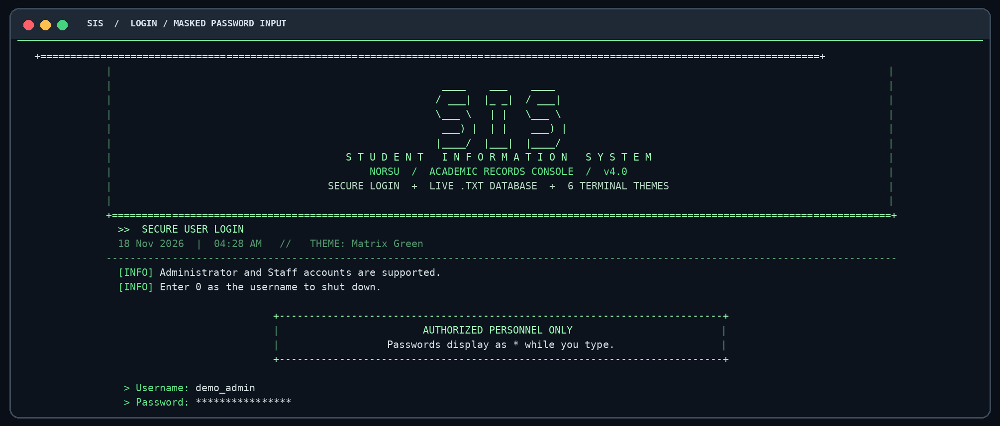

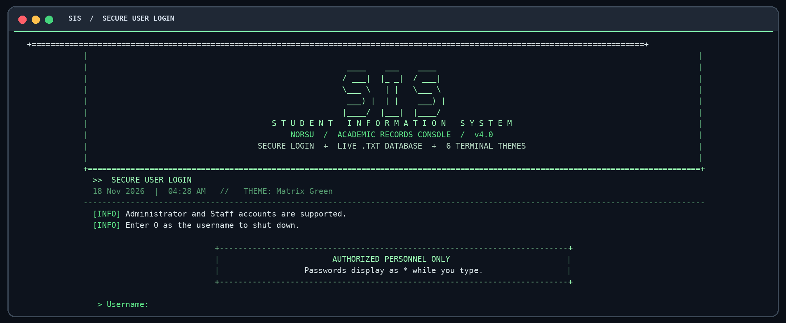

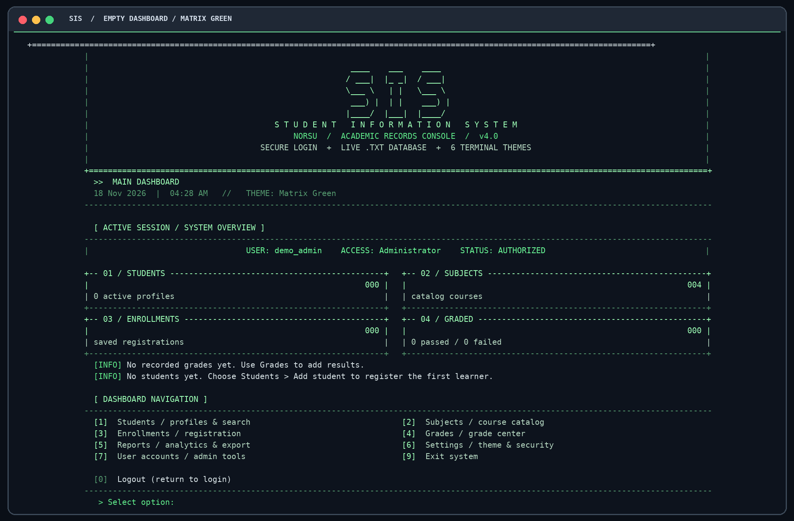

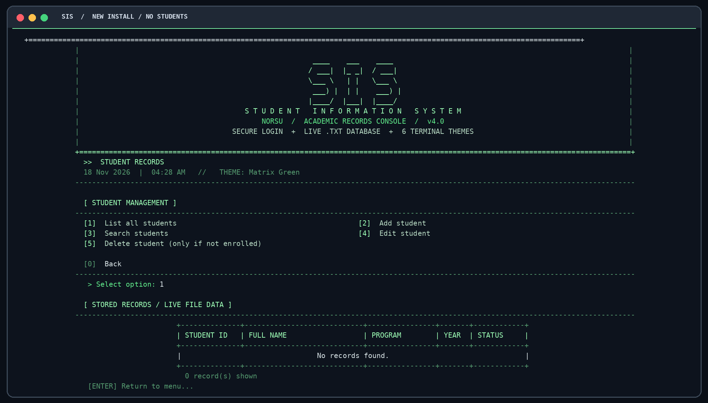

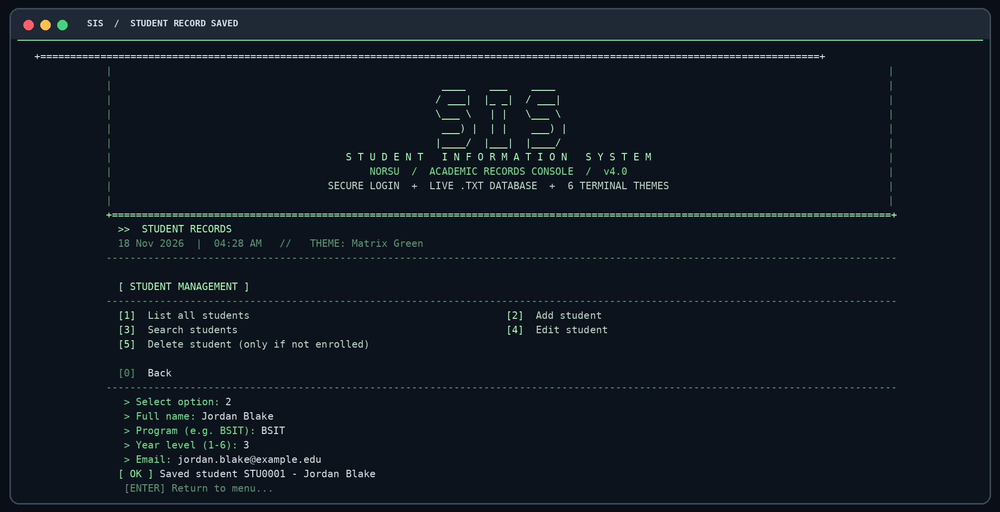

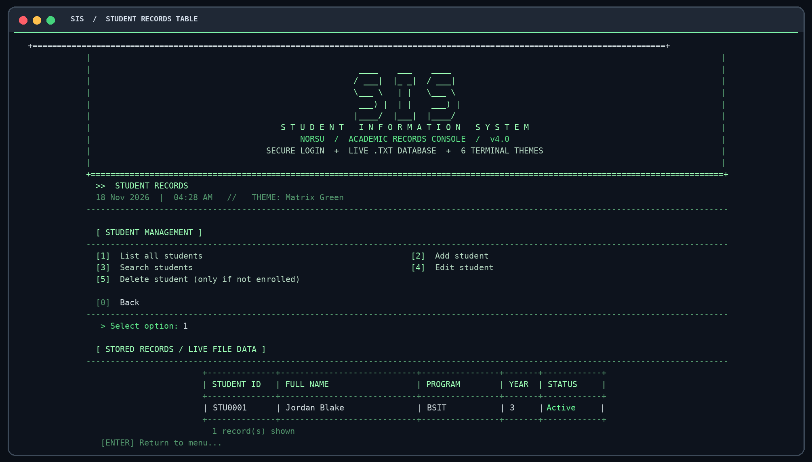

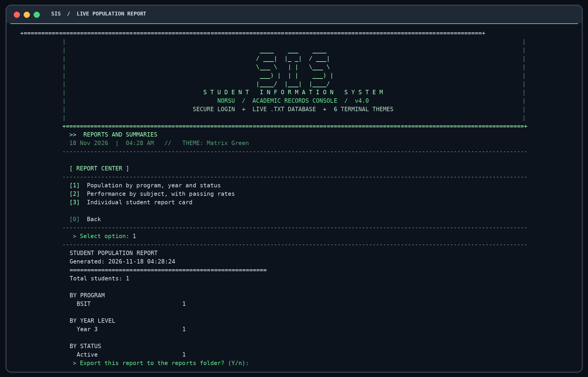

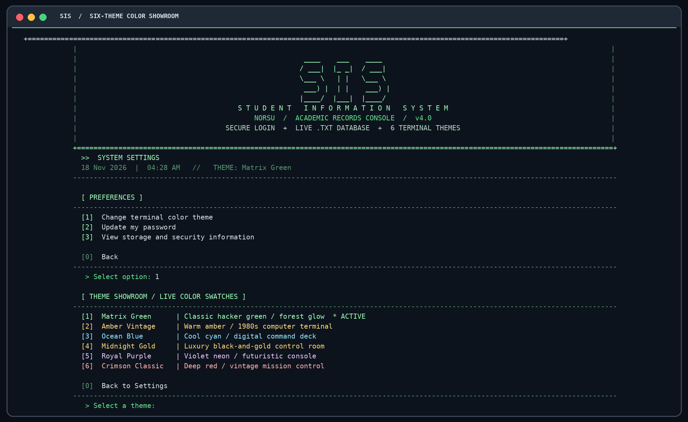

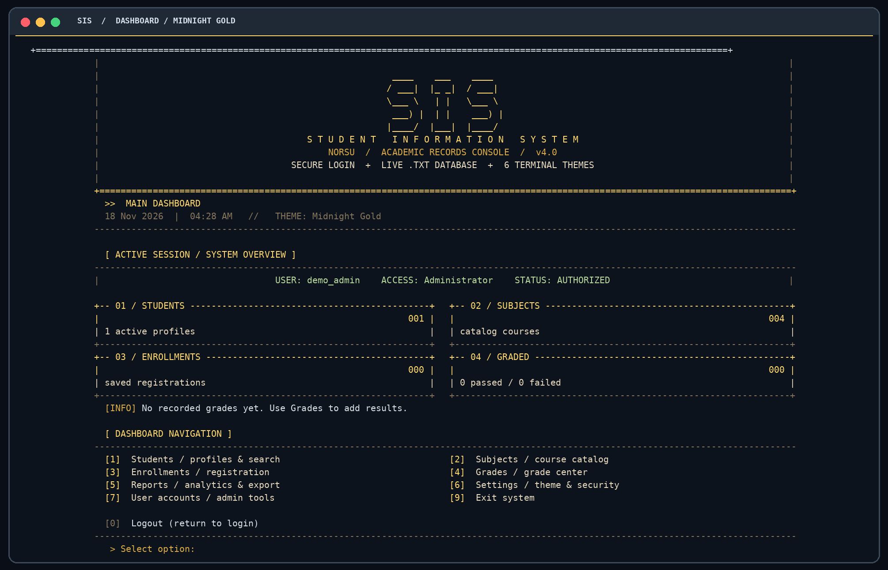

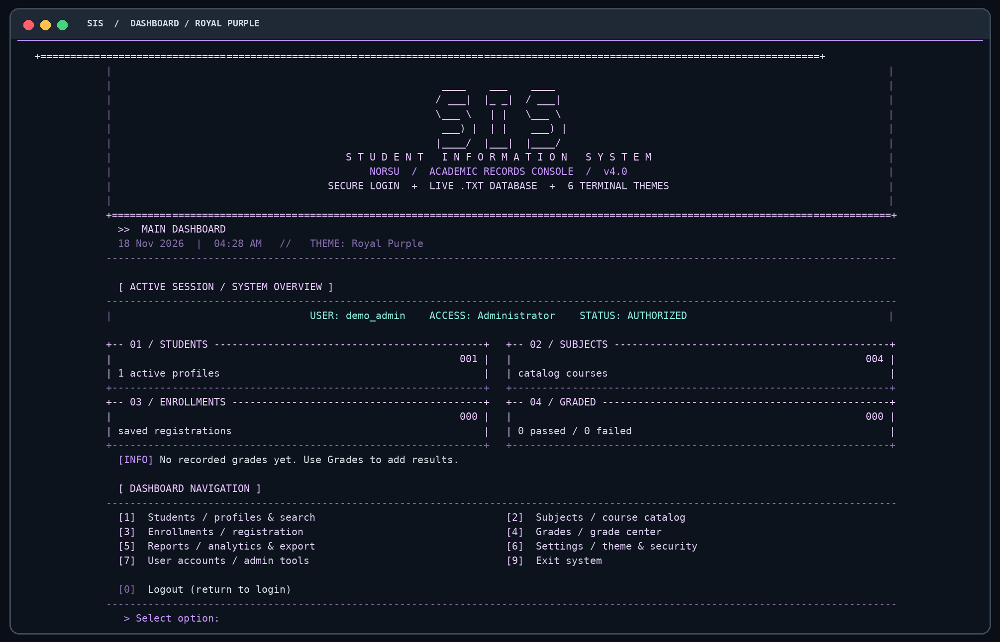

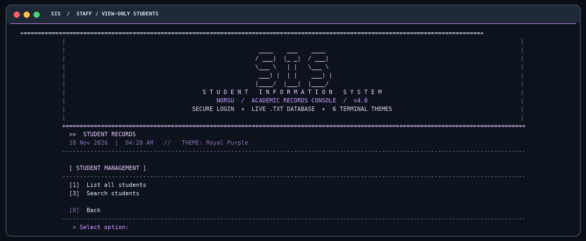

## GitHub and video submission

**You must record and upload your own demonstration.** See [DEMONSTRATION_GUIDE.md](DEMONSTRATION_GUIDE.md) for the talking points and walkthrough. Upload the repo to GitHub **before entering private records**, check that `.gitignore` keeps `data/users.txt` out of Git commits, and include source code, the separate `sample_data/` reference examples, README, and screenshots. Git ignore rules do not protect files manually uploaded through a browser, so review the selected files before clicking Commit. See [GITHUB_SUBMISSION_GUIDE.md](GITHUB_SUBMISSION_GUIDE.md) for step-by-step instructions. Invite **natzjun2@gmail.com** as a collaborator and submit the **GitHub**, **Facebook video**, and **YouTube video** links in your LMS. Ensure the instructor can open each link.

**Important:** This project package does not claim that any GitHub upload, video recording, or social media posting has already happened.

## Learning outcomes covered

Variables; conditionals; `for`/`while` loops; functions; dictionaries, lists, tuples, sets and counters; text file reading, writing and appending; exception handling; secure password hashing; formatted menus/tables; modular programming; aggregation and report generation.
